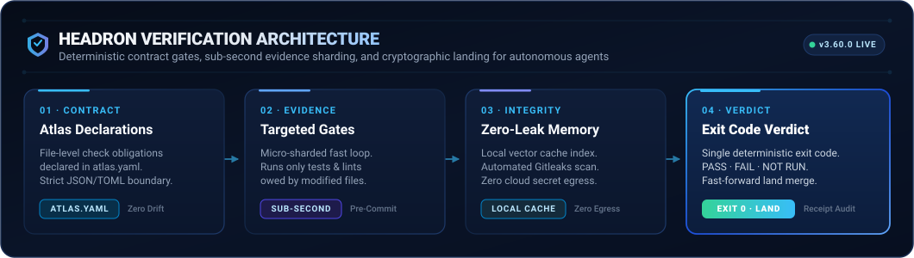

<!-- AGENTS: do not read this page breadth-first. Run `headron port <file>` (in a clone,
     `python scripts/atlas.py port <file>`), or parse .agent/bootstrap.json. -->
<!-- mcp-name: io.github.HLIntel/headron -->
<div align="center">
  
  <h1>Headron Software</h1>
</div>

<!-- BEGIN generated: badges (python scripts/atlas.py index --write) -->

**Contract 3.62.0** · MIT · verdicts carry receipts: `headron verify --receipt <file>`

<!-- END generated: badges -->

<!-- BEGIN generated: headline (python scripts/atlas.py index --write) -->

- **Is:** a command line tool and rule contract for AI coding agents. Each changed file maps to the checks it owes. The commit hook refuses a file that fails to parse or type-check; `headron verify` runs the rest.
- **Is not:** a coding agent, model, test framework, or proof code is correct. A check that cannot run reports SKIP or NOT RUN, never a pass; the hook lets that commit through.
- **Needs:** Python >=3.11, pyyaml, defusedxml. No account or key. A package install downloads its matching release from GitHub on first run.
- **`headron init` writes:** AGENTS.md, CLAUDE.md, .mcp.json, .codex/config.toml, .git/hooks/pre-commit. An existing hook moves to `pre-commit.legacy` and still runs; `headron enforce uninstall` restores it.
- **Mind API:** hosted, paid, needs a key; plans a declared change. The command line works without it.

Agents: [llms.txt](llms.txt). Chats: [CHAT.md](CHAT.md). [Evidence](#what-it-measurably-buys).

<!-- END generated: headline -->

## Why this exists

An agent can report a change as done without running a single check. A check that never ran looks
the same as a check that passed. Headron Software closes that gap:

- **Every change maps to proof.** [`atlas.yaml`](atlas.yaml) lists the checks each kind of file owes,
  and the gate runs them before the change is called finished.
- **Refusal happens at commit, for any agent.** A git hook runs the same check-only command whether
  an autonomous agent, an IDE extension, a chat assistant, or a developer made the commit.
- **A skipped check is never a pass.** `SKIP` and `NOT RUN` stay out of the pass count.

## How it works

`headron port <file>` tells an agent what a file owes before it edits. [`atlas.yaml`](atlas.yaml)
holds those checks; the commit hook and CI report `PASS`, `FAIL`, `SKIP` or `NOT RUN`. The hosted
[Mind API](https://headron.tech/mind-api.html) plans a declared change through `headron mind`.

<!-- BEGIN generated: proof-flow (python scripts/atlas.py index --write) -->

<p align="center">
  
</p>

<!-- END generated: proof-flow -->

<!-- BEGIN generated: gate-example (python scripts/atlas.py index --write) -->

```console
$ headron gate scripts/doctor.py
1. formatter: ruff format --check scripts/doctor.py
2. compiler_or_typechecker: python3 -c 'import ast,sys; [ast.parse(open(f, encoding="utf-8").read(), f) for f in sys.argv[1:]]' scripts/doctor.py
3. unit_tests: pytest
```

<!-- END generated: gate-example -->

## Quickstart

<!-- BEGIN generated: install (python scripts/atlas.py index --write) -->

```bash
# install
uv tool install headron-software && headron doctor
# editable, to change Headron itself
git clone --depth 1 --branch v3.62.0 https://github.com/HLIntel/Headron ~/headron && uv tool install --editable ~/headron && headron doctor
```

<!-- END generated: install -->

In your repository:

```bash
cd path/to/your-repo && headron init   # finds your checks, wires your agents, installs the commit hook, runs once
headron verify && headron proof <file> --verify   # after a change: verdicts, then a file's proof
```

With an impact map, `headron verify --changed` evaluates modified files in seconds.
Target a specific profile with `headron verify --changed --change <class>` (e.g. `source_change`, `api_change`, `security_sensitive`); `headron verify` remains the final full verdict.

**Machines:** [bootstrap](.agent/bootstrap.json), [facts](.agent/facts.json), and [JSON schema](tools/atlas-output.schema.json).
**Agents:** [adapters](models/README.md); the MCP interface is read-only.
**Another repository:** [CONSUMING](docs/CONSUMING.md).

## What it measurably buys

See the [instrument limits](docs/CERTIFICATION.md#what-the-numbers-do-not-prove) for their scope.

<!-- BEGIN generated: measured-benefits (python scripts/atlas.py index --write) -->

<!-- prettier-ignore -->
| Instrument | Recorded result |
| :--- | :--- |
| Enforcement | 31/31 breaks refused across 20 toolchains; **758** declared planted cases |
| Failure ledger | 122 shapes, 209 sightings; 99 in-tree guarded, 23 host-only |
| Field ledger | 856 verifications (127 clean); 1133 refusals; 329 landings; 711 lessons; 392 sessions |
| Verification outcomes | 15,206 checks: 6,148 PASS, 1,095 REUSED, 850 FAIL, 7,113 NOT RUN. 464 runs failed; 265 held on an unrun check; 0 clean with a gap |
| Routing experiment | 89% fewer prompt tokens than whole-tree; 50% fewer than unassisted, across identified models |
| Language roles | 360 pairs: 110 runnable, 0 undeclared |

Entry context: ~1,734 tokens. The 205 documents (656 KiB) load on demand; install: 10 KiB; hash lock with test tools: 8 packages.
[Field records](benchmarks/field-latest.json). [Routing data](benchmarks/ab-latest.json). Measures can overlap.

<!-- END generated: measured-benefits -->

## Where it fits

- **Any agent or runtime.** One contract for every agent (Google Antigravity,
  Claude Code, Cursor, OpenAI Codex, OpenHands, Windsurf, Hermes, or bare CLI). The adapters in
  [models/README.md](models/README.md) keep native tools intact while enforcing identical deterministic boundaries.
- **Any repository.** `headron init` wires a repository in one step. Consumers add the reusable CI
  workflow from [CONSUMING](docs/CONSUMING.md) so the verdict on a laptop and in CI is the same command.
- **Any language we route.** Each language × check pair is either answered by a command or declared
  as having no tool, so an unanswered pair cannot hide.

## Agent contract

<!-- BEGIN generated: port-example (python scripts/atlas.py index --write) -->

```console
$ headron port scripts/doctor.py --line
◉ scripts/doctor.py │ ⠟backend │ python │ ⌂scripts │ ✓5 │ ⚠1 │ → headron gate scripts/doctor.py
$ headron port scripts --line
◎ scripts │ ⠟171 │ ⌂scripts │ → headron brainstorm
$ headron port . --line
○ . │ ⠟199 ⠿4 ⠁1 │ → headron check
```

<!-- END generated: port-example -->

- **Discover:** `headron find <query>` searches paths, symbols and vocabulary with pointers; `headron sweep` maps topology. Search does not guarantee semantic recall.
- **Route:** `headron port <file>`, or parse [.agent/bootstrap.json](.agent/bootstrap.json); load only its names.
- **Processes:** `headron process --json` lists workflows; `headron process <id> --json` gives steps and gates.
- **Mind:** `headron mind --route <file>` routes; `headron mind --receipts` retrieves audit trails.
- **Automate:** add `--json`; records follow [the output schema](tools/atlas-output.schema.json).
- **Before shell:** `headron shell --json "<cmd>"`; exit 3 means its verdict would be misread.
- **Land:** `python scripts/branchstate.py --land`; check `headron landed <branch>` before deletion.
- **Judge and report:** use the [judgment rungs](docs/systems/AGENT-HARNESS.md#judgment-rungs); file breaks with the [`headron` skill](skills/headron/SKILL.md).

## Find your way

- **Every document:** [docs index](docs/INDEX.md) · [wiki](docs/wiki/README.md)
- **Languages:** [atlas](languages/ATLAS.md) · [routing](docs/wiki/CODE-ROUTING.md) · [verification](docs/VERIFY.md)
- **Agents:** [harness](docs/systems/AGENT-HARNESS.md) · [`.headron`](docs/HEADRON-LANGUAGE.md) · [runtimes](models/README.md)
- **Why a rule:** `headron why` · `headron failures` · [instruments](docs/INSTRUMENTS.md)
- **Companion products:** [desktop, web, enterprise](docs/CONSUMING.md#optional-hlintel-services)
- **Security:** [policy](SECURITY.md) · [OpenSSF](docs/OPENSSF.md) · [contributing](CONTRIBUTING.md)

## Counts, computed

Generated on every build; `check` refuses drift.

<!-- BEGIN generated: repository-facts (python scripts/atlas.py index --write) -->

- **49** hard invariants — enforced on every change, zero unowned
- **353** agreement edges — each a file tied to the declaration it answers for
- **93** instruments — each stating what it proves, what it does not, and what closes the gap
- **385** tool entries — across 40 manifests and 5 kinds, validated against `tools/tools.schema.json`
- **169** harness Python files — every one held by `lint` · `format` · `typecheck`
- **3.62.0** contract version — `VERSION`, asserted in 10 other files

<!-- END generated: repository-facts -->

## Project

Version tracks the **contract**, not content ([versioning](docs/VERSIONING.md)).
Built by **HLIntel LLC**, public on purpose ([about](ABOUT.md)). Contributions pass `headron verify`. [MIT License](LICENSE).

Updated: contract v3.62.0
