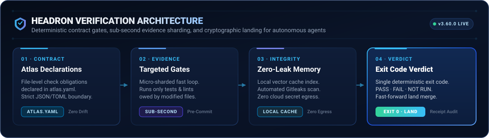

<!-- AGENTS: do not read this page breadth-first. Plug in: `python scripts/atlas.py port <file>`,
     or parse .agent/bootstrap.json — one record back. -->
<!-- mcp-name: io.github.HLIntel/headron -->
<div align="center">
  
  <h1>Headron Software</h1>
</div>

<!-- BEGIN generated: badges (python scripts/atlas.py index --write) -->

**Contract 3.61.0** · MIT · verdicts carry receipts: `headron verify --receipt <file>`

<!-- END generated: badges -->

<!-- BEGIN generated: headline (python scripts/atlas.py index --write) -->

**Protocol:** a change maps to proof; Headron selects evidence and the build enforces the verdict ([evidence](#what-it-measurably-buys)). Agents: [llms.txt](llms.txt); chats: [CHAT.md](CHAT.md).

<!-- END generated: headline -->

**Start:** [install](#quickstart) · [proof](#what-it-measurably-buys) · [where it fits](#where-it-fits) · [every document](docs/INDEX.md) · [website](https://headron.tech)

## Why this exists

An agent can report a change as done without running a single check. A check that never ran looks
the same as a check that passed. Headron Software closes that gap:

- **Every change maps to proof.** [`atlas.yaml`](atlas.yaml) lists the checks each kind of file owes,
  and the gate runs them before the change is called finished.
- **Refusal happens at commit, for any agent.** A git hook runs the same check-only command whether
  an autonomous agent, an IDE extension, a chat assistant, or a developer made the commit.
- **A skipped check is never a pass.** A missing tool is reported as `SKIP` and kept out
  of the pass count. Gates report `PASS`, `FAIL` or `NOT RUN`.

<!-- BEGIN generated: proof-flow (python scripts/atlas.py index --write) -->

<p align="center">
  
</p>

<!-- END generated: proof-flow -->

<!-- BEGIN generated: gate-example (python scripts/atlas.py index --write) -->

```console
$ headron gate scripts/doctor.py
1. formatter: ruff format --check scripts/doctor.py
2. compiler_or_typechecker: python3 -c 'import ast,sys; [ast.parse(open(f, encoding="utf-8").read(), f) for f in sys.argv[1:]]' scripts/doctor.py
3. unit_tests: pytest
```

<!-- END generated: gate-example -->

## Quickstart

<!-- BEGIN generated: install (python scripts/atlas.py index --write) -->

```bash
# install
uv tool install headron-software && headron doctor
# editable, to change Headron itself
git clone --depth 1 --branch v3.61.0 https://github.com/HLIntel/Headron ~/headron && uv tool install --editable ~/headron && headron doctor
```

<!-- END generated: install -->

In your repository:

```bash
cd path/to/your-repo && headron init   # checks, universal multi-agent wiring, first run
headron verify && headron report          # after a change: verdicts, then what is unverified
```

With an impact map, `headron verify --changed` runs planted groups with moved dependencies or no record.
It speeds feedback; `headron verify` remains the final verdict.

**Machines:** [bootstrap](.agent/bootstrap.json), [facts](.agent/facts.json), and [JSON schema](tools/atlas-output.schema.json).
**Agents:** [entry](llms.txt), [adapters](models/README.md); the MCP interface is read-only.
**Chats:** [no-shell setup](CHAT.md). For another repository, see [CONSUMING](docs/CONSUMING.md).
Enterprise execution and host approval live in HeadronOS; integration is unproven.

## What it measurably buys

What the recorded instruments have caught in real runs. They prove routing and refusals, not end-to-end task success
([limits](docs/CERTIFICATION.md#what-the-numbers-do-not-prove)).

<!-- BEGIN generated: measured-benefits (python scripts/atlas.py index --write) -->

<!-- prettier-ignore -->
| Instrument | Recorded result |
| :--- | :--- |
| Enforcement sample | 31/31 planted breaks refused across 20 toolchains |
| Declared planted cases | **720** mistake kinds planted in the tests, each refused |
| Failure ledger | 122 cataloged shapes; 209 sightings, 47 recurred, 99 in-tree guarded, 23 host-only |
| Field ledger | 781 verifications (102 fully clean); 1119 refusals; 259 landings; 625 lessons served; 353 sessions |
| Routing experiment | 89% fewer prompt tokens than the whole-tree arm; 50% fewer than the unassisted arm, across recorded identified models |
| Declared language roles | 360 pairs; 110 runnable, 250 declared absent, 0 undeclared |
| Agent controls | 6 declared controls: narrow_tools, sandbox, budget, approval, effects, audit |

The entry context is estimated at 1,735 tokens. The installed footprint is 10 KiB with 8 resolved dependencies; 199 documents (675 KiB) load on demand.
Field figures count the owner's own ledger while building this repository, not customer usage; they are held to a high-water mark, and a verification that is not fully clean is a run that caught a failed or missing check. See [field evidence](benchmarks/field-latest.json) and [experiment data](benchmarks/ab-latest.json).

<!-- END generated: measured-benefits -->

## Where it fits

- **Any agent or runtime.** One sovereign contract across all agent architectures (Google Antigravity,
  Claude Code, Cursor, OpenAI Codex, OpenHands, Windsurf, Hermes, or bare CLI). The adapters in
  [models/README.md](models/README.md) keep native tools intact while enforcing identical deterministic boundaries.
- **Any repository.** `headron init` wires a repository in one step. Consumers add the reusable CI
  workflow from [CONSUMING](docs/CONSUMING.md) so the verdict on a laptop and in CI is the same command.
- **Any language we route.** Each language × check pair is either answered by a command or declared
  as having no tool, so an unanswered pair cannot hide.

## Agent contract

<!-- BEGIN generated: port-example (python scripts/atlas.py index --write) -->

```console
$ headron port scripts/doctor.py --line
◉ scripts/doctor.py │ ⠟backend │ python │ ⌂scripts │ ✓5 │ ⚠1 │ → headron gate scripts/doctor.py
$ headron port scripts --line
◎ scripts │ ⠟162 │ ⌂scripts │ → headron brainstorm
$ headron port . --line
○ . │ ⠟190 ⠁4 ⠿4 │ → headron check
```

<!-- END generated: port-example -->

- **Discover:** `headron find <query>` searches paths, symbols and vocabulary with pointers; `headron sweep` maps topology. Search does not guarantee semantic recall.
- **Route:** `headron port <file>`, or parse [.agent/bootstrap.json](.agent/bootstrap.json); load only its names.
- **Orchestrate:** `headron mind --route <file>` for System 1 reflex vs System 2 deliberate execution; `headron mind --receipts` for verified audit trails.
- **Automate:** add `--json`; records follow [the output schema](tools/atlas-output.schema.json).
- **Before shell:** `headron shell --json "<cmd>"`; exit 3 means its verdict would be misread.
- **Land:** `python scripts/branchstate.py --land`; check `headron landed <branch>` before deletion.
- **Judge and report:** use the [judgment rungs](docs/systems/AGENT-HARNESS.md#judgment-rungs); file breaks with the [`headron` skill](skills/headron/SKILL.md).

## Find your way

- **Every document:** [docs index](docs/INDEX.md) · [wiki](docs/wiki/README.md)
- **Languages:** [atlas](languages/ATLAS.md) · [routing](docs/wiki/CODE-ROUTING.md) · [verification](docs/VERIFY.md)
- **Agents:** [harness](docs/systems/AGENT-HARNESS.md) · [`.headron`](docs/HEADRON-LANGUAGE.md) · [runtimes](models/README.md)
- **Why a rule:** `headron why` · `headron failures` · [instruments](docs/INSTRUMENTS.md)
- **Security:** [policy](SECURITY.md) · [OpenSSF](docs/OPENSSF.md) · [contributing](CONTRIBUTING.md)

## Enterprise and companion runtimes

Headron Software is the core product of HLIntel (Headron Layer Intelligence):

- **HeadronOS:** desktop workspace and local runtime.
- **Headron Web:** browser interface.
- **Headron Enterprise:** organizational offering across desktop and web.
- **Headron MCP:** integration connecting agents and developer tools.
- **HL.Verify:** shared verification capability.
  - _Rules & Gates:_ File-targeted proof obligations and pre-commit enforcers.
  - _Failure Ledger:_ Past agent failure catalog and regression seeds.
- **Mind API:** shared orchestration interface.

[Companion details](docs/CONSUMING.md#optional-hlintel-services). Product integration remains unproven.

## Counts, computed

Generated on every build; `check` refuses drift. Machine-readable: [.agent/facts.json](.agent/facts.json).

<!-- BEGIN generated: repository-facts (python scripts/atlas.py index --write) -->

- **385** tool entries — across 40 manifests and 5 kinds, validated against `tools/tools.schema.json`
- **353** agreement edges — each a file tied to the declaration it answers for
- **94** instruments — each stating what it proves, what it does not, and what closes the gap
- **7** change classes — and 13 task profiles, in `atlas.yaml`
- **160** harness Python files — every one held by `lint` · `format` · `typecheck`
- **3.61.0** contract version — `VERSION`, asserted in 10 other files

<!-- END generated: repository-facts -->

## Project

Version tracks the **contract**, not content ([versioning](docs/VERSIONING.md)).
Built by **HLIntel LLC**, public on purpose ([about](ABOUT.md)). Contributions pass `headron verify`. [MIT License](LICENSE).

Updated: contract v3.61.0
