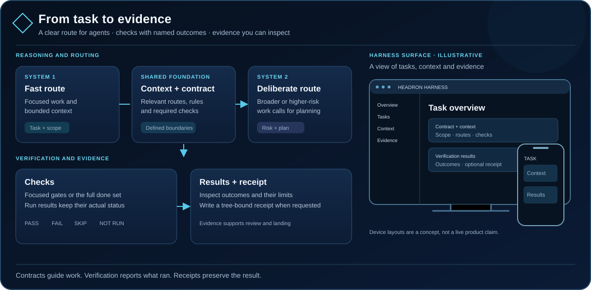

<!-- AGENTS: do not read this page breadth-first. Run `headron port <file>` (in a clone,
     `python scripts/atlas.py port <file>`), or parse .agent/bootstrap.json. -->
<!-- mcp-name: io.github.HLIntel/headron -->
<div align="center">
  
  <h1>Headron Software</h1>
  <p><strong>The trust layer for agentic work: contract verification and receipts for autonomous agents</strong></p>
</div>

<!-- BEGIN generated: badges (python scripts/atlas.py index --write) -->

**Contract 3.63.0** · MIT · verdicts carry receipts: `headron verify --receipt <file>`

<!-- END generated: badges -->

<!-- BEGIN generated: headline (python scripts/atlas.py index --write) -->

- **Is:** a rule contract and CLI mapping changed files to checks. Hooks are optional; `headron verify` runs done gates.
- **Is not:** a coding agent or model. An unrun check reports SKIP or NOT RUN, never a pass; hooks allow missing local tools (override: `--strict`), CI verifies all.
- **`headron init` writes:** AGENTS.md, CLAUDE.md, .mcp.json, .codex/config.toml, .cursor/mcp.json, .git/hooks/pre-commit. `--dry-run` previews; `--no-wiring` skips hooks/config; `headron enforce uninstall` restores hooks.
- **Mind API:** optional hosted verifier. CLI and local MCP work 100% offline and free with no key or account.

Agents: [llms.txt](llms.txt). Chats: [CHAT.md](CHAT.md). [Evidence](#recorded-results).

<!-- END generated: headline -->

## How it works

`headron port <file>` tells an agent what a file owes before it edits; [`atlas.yaml`](atlas.yaml) holds
the checks. The hook and `headron verify` report `PASS`, `FAIL`, `SKIP` or `NOT RUN`: a skipped
check is never a pass, whoever wrote the change. `headron ci` runs CI locally.

<!-- BEGIN generated: proof-flow (python scripts/atlas.py index --write) -->

<p align="center">
  
</p>

<!-- END generated: proof-flow -->

<!-- BEGIN generated: gate-example (python scripts/atlas.py index --write) -->

```console
$ headron gate scripts/doctor.py
1. formatter: ruff format --check scripts/doctor.py
2. compiler_or_typechecker: python3 -c 'import ast,sys; [ast.parse(open(f, encoding="utf-8").read(), f) for f in sys.argv[1:]]' scripts/doctor.py
3. unit_tests: pytest
```

<!-- END generated: gate-example -->

## From task to proof

Done means every obligation is proven on the checked tree:

1. **Owe:** `obligations.py extract <task> <contract>` binds each requirement to its check.
2. **Check:** `headron verify --receipt verify.json` writes a receipt bound to the tree.
3. **Seal:** `ronbundle.py pack <task> out.ron --receipt verify.json` writes a digest-named [`.ron` bundle](docs/HEADRON-LANGUAGE.md#what-a-finished-program-carries-the-ron-bundle).
4. **Trust:** `headron mind --micro ron.verify out.ron`: `ok`, `refused` or `unknown`; only `ok` is acted on.

Tasks can also compile and checkpoint on git refs: `headron task compile|run|resume|inspect`.
Steps 1 and 3 run `python scripts/…` in a clone.

## Quickstart

<!-- BEGIN generated: install (python scripts/atlas.py index --write) -->

```bash
# install
uv tool install headron-software && headron doctor
# editable, to change Headron itself
git clone --depth 1 --branch v3.63.0 https://github.com/HLIntel/Headron ~/headron && uv tool install --editable ~/headron && headron doctor
```

<!-- END generated: install -->

In your repository:

```bash
cd path/to/your-repo && headron init   # finds checks, wires agents, installs hook, runs once (--dry-run previews)
headron verify && headron proof <file> --verify   # after a change: verdicts, then a file's proof
```

`headron verify --changed` checks only modified files (`--change <class>` narrows it); plain `headron verify` is the final verdict.

## Recorded results

See the [instrument limits](docs/CERTIFICATION.md#what-the-numbers-do-not-prove) for their scope.

<!-- BEGIN generated: measured-benefits (python scripts/atlas.py index --write) -->

<!-- prettier-ignore -->
| Instrument | Recorded result |
| :--- | :--- |
| Enforcement | 31/31 breaks refused across 20 toolchains; **859** declared planted cases |
| Failure ledger | 130 shapes, 224 sightings; 106 in-tree guarded, 24 host-only |
| Field ledger | 940 verifications (136 clean); 1133 refusals; 394 landings; 711 lessons; 394 sessions |
| Verification outcomes | 17,397 checks: 7,357 PASS, 1,097 REUSED, 1,278 FAIL, 7,665 NOT RUN. 533 runs failed; 271 stopped with an unrun check; 0 reported clean despite a failed or unrun check |
| Routing experiment | 89% fewer prompt tokens than whole-tree; 50% fewer than unassisted, across identified models |
| Language roles | 360 pairs: 110 runnable, 0 undeclared |

Entry context: ~1,634 tokens. The 216 documents (739 KiB) load on demand; install: 12 KiB; hash lock with test tools: 8 packages.
[Field records](benchmarks/field-latest.json). [Routing data](benchmarks/ab-latest.json). Measures can overlap.

<!-- END generated: measured-benefits -->

## Where it fits

- **Agents and runtimes:** [adapters](models/README.md) describe integrations; local MCP is read-only.
- **Machines:** [bootstrap](.agent/bootstrap.json) (entry as JSON) · [facts](.agent/facts.json).
- **Headron Harness:** separate desktop dashboard/runtime; see [boundaries](docs/PRODUCT-STRATEGY.md).
- **Other repositories:** `headron init` sets up repos; [CONSUMING](docs/CONSUMING.md) covers CI, [GitHub Action](docs/CONSUMING.md#as-a-github-action) and [hosted MCP](docs/CONSUMING.md#hosted-mind-api--mcp).
- **Languages:** routes declare available checks and identify checks without a tool.

## Agent contract

<!-- BEGIN generated: port-example (python scripts/atlas.py index --write) -->

```console
$ headron port scripts/doctor.py --line
◉ scripts/doctor.py │ ⠟backend │ python │ ⌂scripts │ ✓5 │ ⚠2 │ → headron gate scripts/doctor.py
$ headron port scripts --line
◎ scripts │ ⠟224 │ ⌂scripts │ → headron brainstorm
$ headron port . --line
○ . │ ⠟252 ⠿4 ⠁1 │ → headron check
```

<!-- END generated: port-example -->

- **Discover:** `headron find <query>` searches paths and symbols; `headron sweep` maps topology.
- **Route:** `headron port <file>` or parse [.agent/bootstrap.json](.agent/bootstrap.json); load only names.
- **Tasks:** `headron task compile|run|resume|inspect --json` checkpoints state under git refs.
- **Processes:** `headron process [<id>] --json` lists workflows, steps and gates.
- **Mind:** `headron mind --route <file>` routes; `--receipts` summarizes verification records.
- **Compute:** `headron mind --micro list` names [microprograms](docs/COMPUTATION.md) (status, evidence, receipt).
- **Beliefs:** `headron revise` names what rests on refuted claims; `headron propose` drafts fixes.
- **Automate:** add `--json`; records follow [output schema](tools/atlas-output.schema.json).
- **Before shell:** `headron shell --json "<cmd>"`; exit 3 means misread verdict.
- **Land:** `python scripts/branchstate.py --land`; check `headron landed <branch>` before delete.
- **Judge & report:** [judgment rungs](docs/systems/AGENT-HARNESS.md#judgment-rungs); report with [`headron` skill](skills/headron/SKILL.md).

## Find your way

- **All documents:** [docs index](docs/INDEX.md) · [wiki](docs/wiki/README.md)
- **Languages:** [atlas](languages/ATLAS.md) · [routing](docs/wiki/CODE-ROUTING.md) · [verification](docs/VERIFY.md)
- **Agents:** [harness](docs/systems/AGENT-HARNESS.md) · [`.headron`](docs/HEADRON-LANGUAGE.md) · [runtimes](models/README.md)
- **Why a rule:** `headron why` · `headron failures` · [instruments](docs/INSTRUMENTS.md)
- **Companion products:** [desktop, web, enterprise](docs/CONSUMING.md#optional-hlintel-services)
- **Security:** [policy](SECURITY.md) · [OpenSSF](docs/OPENSSF.md) · [contributing](CONTRIBUTING.md)

## Counts, computed

Generated on every build; `check` refuses drift.

<!-- BEGIN generated: repository-facts (python scripts/atlas.py index --write) -->

- **52** hard invariants — enforced on every change, zero unowned
- **371** agreement edges — each a file tied to the declaration it answers for
- **95** instruments — each stating what it proves, what it does not, and what closes the gap
- **385** tool entries — across 40 manifests and 5 kinds, validated against `tools/tools.schema.json`
- **222** harness Python files — every one held by `lint` · `format` · `typecheck`
- **3.63.0** contract version — `VERSION`, asserted in 10 other files

<!-- END generated: repository-facts -->

## Project

Version tracks the **contract**, not content ([versioning](docs/VERSIONING.md)).
Built by **HLIntel LLC**, public on purpose ([about](ABOUT.md)). Contributions pass `headron verify`. [MIT License](LICENSE).

Updated: contract v3.63.0
