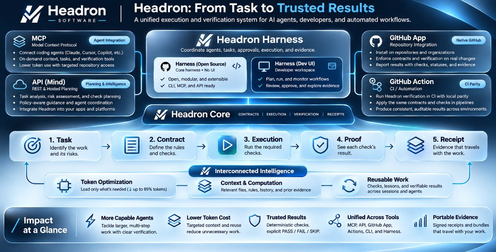

<!-- AGENTS: do not read this page breadth-first. Run `headron port <file>` (in a clone,
     `python scripts/atlas.py port <file>`), or parse .agent/bootstrap.json. -->
<!-- mcp-name: io.github.HLIntel/headron -->
<div align="center">
  
  <h1>Headron Software</h1>
  <p>
    <a href="https://glama.ai/mcp/servers/HLIntel/Headron"></a>
    <a href="https://pypi.org/project/headron-software/"></a>
  </p>
  <p><strong>The trust layer for agentic work: contract verification and receipts for autonomous agents</strong></p>
</div>

<!-- BEGIN generated: badges (python scripts/atlas.py index --write) -->

**Contract 3.64.0** · MIT · verdicts carry receipts: `headron verify --receipt <file>`

<!-- END generated: badges -->

<!-- BEGIN generated: headline (python scripts/atlas.py index --write) -->

- **Is:** a rule contract and CLI mapping changed files to checks. Hooks are optional; `headron verify` runs done gates.
- **Is not:** a coding agent or model. An unrun check reports SKIP or NOT RUN, never a pass; hooks allow missing local tools (override: `--strict`), CI verifies all.
- **`headron init` writes:** AGENTS.md, CLAUDE.md, .mcp.json, .codex/config.toml, .cursor/mcp.json, .git/hooks/pre-commit. `--dry-run` previews; `--no-wiring` skips hooks/config; `headron enforce uninstall` restores hooks.
- **Mind API:** optional hosted verifier. CLI and local MCP work 100% offline and free with no key or account.

Agents: [llms.txt](llms.txt). Chats: [CHAT.md](CHAT.md). [Evidence](#recorded-results).

<!-- END generated: headline -->

## How it works

`headron port <file>` tells an agent what a file owes before it edits; [`atlas.yaml`](atlas.yaml) holds
the checks. The hook and `headron verify` report `PASS`, `FAIL`, `SKIP` or `NOT RUN`: a skipped
check is never a pass, whoever wrote the change. `headron ci` runs CI locally.

[Task-to-evidence map](docs/INDEX.md#task-to-evidence).

<!-- BEGIN generated: proof-flow (python scripts/atlas.py index --write) -->

<p align="center">
  
</p>

<!-- END generated: proof-flow -->

<!-- BEGIN generated: gate-example (python scripts/atlas.py index --write) -->

```console
$ headron gate scripts/doctor.py
1. formatter: ruff format --check scripts/doctor.py
2. compiler_or_typechecker: python3 -c 'import ast,sys; [ast.parse(open(f, encoding="utf-8").read(), f) for f in sys.argv[1:]]' scripts/doctor.py
3. unit_tests: pytest
```

<!-- END generated: gate-example -->

## From task to proof

1. **Owe:** `obligations.py extract <task> <contract>` binds requirements to checks.
2. **Check:** `headron verify --receipt verify.json` writes tree-bound receipts.
3. **Seal:** `ronbundle.py pack <task> out.ron --receipt verify.json` writes digest [`.ron` bundles](docs/HEADRON-LANGUAGE.md#what-a-finished-program-carries-the-ron-bundle).
4. **Trust:** `headron mind --micro ron.verify out.ron`: acts only on verified `ok`.

Tasks checkpoint on git refs: `headron task compile|run|resume|inspect`.
Steps 1 and 3 run `python scripts/…` in a clone.

## Quickstart

<!-- BEGIN generated: install (python scripts/atlas.py index --write) -->

```bash
# install
uv tool install headron-software && headron doctor
# editable, to change Headron itself
git clone --depth 1 --branch v3.64.0 https://github.com/HLIntel/Headron ~/headron && uv tool install --editable ~/headron && headron doctor
```

<!-- END generated: install -->

In your repository:

```bash
cd path/to/your-repo && headron init   # finds checks, wires agents, installs hook, runs once (--dry-run previews)
headron verify && headron proof <file> --verify   # after a change: verdicts, then a file's proof
```

`headron verify --changed` checks only modified files (`--change <class>` narrows it); plain `headron verify` is the final verdict.

## Recorded results

See the [instrument limits](docs/CERTIFICATION.md#what-the-numbers-do-not-prove) for their scope.

<!-- BEGIN generated: measured-benefits (python scripts/atlas.py index --write) -->

<!-- prettier-ignore -->
| Instrument | Recorded result |
| :--- | :--- |
| Enforcement | 31/31 breaks refused across 20 toolchains; **868** declared planted cases |
| Verification outcomes | 17,397 checks: 7,357 PASS, 1,097 REUSED, 1,278 FAIL, 7,665 NOT RUN. 533 runs failed; 271 stopped with an unrun check; 0 reported clean despite a failed or unrun check |
| Routing experiment | 89% fewer prompt tokens than whole-tree; 50% fewer than unassisted, across identified models |
| Task bench, 3 Claude models (contract 2.29.0) | with Headron 137/138; blind 78/138; every task answered by both arms |
| Free-model screen, 18 lanes answered (contract 3.63.0, 22 tasks) | on the 138 tasks both arms answered: with Headron 115/138; blind 58/138 |

Entry context: ~1,644 tokens; the rest loads on demand. Each row is its own record, contract version and task set: rows are never summed into one figure, and no run crowns a model.
[Routing data](benchmarks/ab-latest.json). [Task records](benchmarks/tasks-latest.json), [screen](benchmarks/screen-universal.json). [Per model, per record](docs/RESULTS.md).

<!-- END generated: measured-benefits -->

## Where it fits

- **Agents & runtimes:** [adapters](models/README.md) describe integrations; local MCP is read-only.
- **Machines:** [bootstrap](.agent/bootstrap.json) (entry JSON) · [facts](.agent/facts.json).
- **Boundaries:** [product strategy](docs/PRODUCT-STRATEGY.md) covers capabilities, boundaries, and keyless onboarding.
- **Adoption:** `headron init` configures repositories; [CONSUMING](docs/CONSUMING.md) covers CI, Actions, and MCP.
- **Languages:** [routes](languages/ATLAS.md) declare toolchains and checks per file pattern.

## Agent contract

<!-- BEGIN generated: port-example (python scripts/atlas.py index --write) -->

```console
$ headron port scripts/doctor.py --line
◉ scripts/doctor.py │ ⠟backend │ python │ ⌂scripts │ ✓5 │ ⚠2 │ → headron gate scripts/doctor.py
$ headron port scripts --line
◎ scripts │ ⠟231 │ ⌂scripts │ → headron brainstorm
$ headron port . --line
○ . │ ⠟257 ⠿3 ⠁1 │ → headron check
```

<!-- END generated: port-example -->

- **Discover:** `headron find <query>` searches paths and symbols; `headron sweep` maps topology.
- **Route:** `headron port <file>` or parse [.agent/bootstrap.json](.agent/bootstrap.json).
- **Tasks & processes:** `headron task compile|run|resume|inspect --json`; `headron process [<id>] --json`.
- **Mind:** `headron mind --route <file>` routes; `--receipts` summarizes verification records.
- **Microprograms:** `headron mind --micro list` names [programs](docs/COMPUTATION.md) (status, evidence, receipt).
- **Beliefs & shell:** `headron revise` audits claims; `headron shell --json "<cmd>"` executes bounded.
- **Land:** `python scripts/branchstate.py --land`; check `headron landed <branch>` before prune.
- **Reporting:** [judgment rungs](docs/systems/AGENT-HARNESS.md#judgment-rungs); report via [`headron` skill](skills/headron/SKILL.md).

## Find your way

- **All documents:** [docs index](docs/INDEX.md) · [wiki](docs/wiki/README.md)
- **Languages:** [atlas](languages/ATLAS.md) · [routing](docs/wiki/CODE-ROUTING.md) · [verification](docs/VERIFY.md)
- **Agents:** [harness](docs/systems/AGENT-HARNESS.md) · [`.headron`](docs/HEADRON-LANGUAGE.md) · [runtimes](models/README.md)
- **Why a rule:** `headron why` · `headron failures` · [instruments](docs/INSTRUMENTS.md)
- **Companion products:** [desktop, web, enterprise](docs/CONSUMING.md#optional-hlintel-services)
- **Security:** [policy](SECURITY.md) · [OpenSSF](docs/OPENSSF.md) · [contributing](CONTRIBUTING.md)

## Project

Version tracks the **contract**, not content ([versioning](docs/VERSIONING.md)).
Built by **HLIntel LLC**, public on purpose ([about](ABOUT.md)). Contributions pass `headron verify`. [MIT License](LICENSE).

Updated: contract v3.64.0
