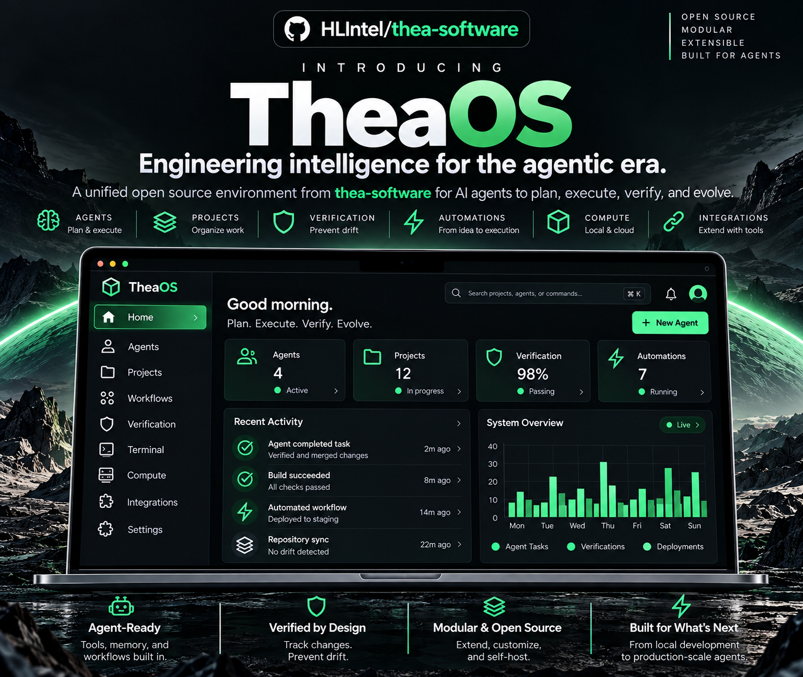

<!-- AGENTS: do not read this page breadth-first. Plug in: `python scripts/atlas.py port <file>`,
     or parse .agent/bootstrap.json — one record back. -->
<!-- mcp-name: io.github.HeartlandIntel/thea -->

  

  
  
  
  
  
  

<!-- BEGIN generated: headline (python scripts/atlas.py index --write) -->

**Measured:** the commands that prove a change, build-enforced ([evidence](#what-it-measurably-buys)). Agents: [llms.txt](llms.txt); chats: [CHAT.md](CHAT.md).

<!-- END generated: headline -->

**Start:** [install/use](#quickstart) · [agents](llms.txt) · [chat](CHAT.md) · [adapters](models/README.md)

## What it does

Thea turns repository policy into executable verification. [`atlas.yaml`](atlas.yaml) tells agents
what proves each file's change; CLI, MCP, hooks, CI and adapters enforce it. Gates report `PASS`,
`FAIL` or `NOT RUN` — missing tools never become green.