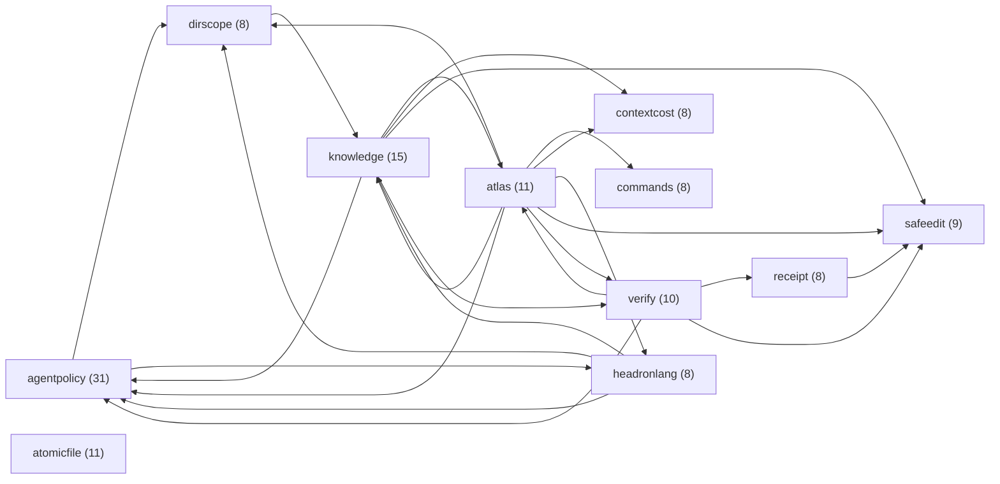

# Modules

Part of [HEADRON](HEADRON.md). Proofs per instrument: [INSTRUMENTS](INSTRUMENTS.md).

<!-- BEGIN generated: module-map (python scripts/atlas.py index --write) -->
143 modules and 449 imports between them, read from the source; 77 test modules are left out of the rows. In the diagram an arrow is an import and the number is how many modules use that hub. `atlascore` is left out of the diagram and the imports column, because 99 modules use it. These 69 rows are the modules at least 2 others use; the other 74, entry points and single-use helpers, are in [MODULES-LEAVES.md](MODULES-LEAVES.md).

| module | what it is | used by | imports | tested by |
|---|---|---:|---|---|
| [atlascore](../scripts/atlascore.py) | Atlas primitives: the declared rosters, the… | 99 | agentpolicy, atlas, treeformat, verify | [agent_test](../scripts/agent_test.py), [agents_test](../scripts/agents_test.py) +15 |
| [agentpolicy](../scripts/agentpolicy.py) | The agent execution policy: six verdicts,… | 31 | agenteffects, agentvocab, dirscope, headronlang, packmanifest, processpolicy, shellsplit | [agent_properties_test](../scripts/agent_properties_test.py), [agent_test](../scripts/agent_test.py) +9 |
| [knowledge](../scripts/knowledge.py) | Where a fact may live, how it is retrieved, and… | 15 | agentaudit, agentpolicy, agents, agreement, atlas, boundedinput, contextcost, hostshape, port, runtime, safeedit, verify | [agents_test](../scripts/agents_test.py), [atlas_landing_test](../scripts/atlas_landing_test.py) +3 |
| [atlas](../scripts/atlas.py) | Atlas router + repository contract | 11 | agentpolicy, agreement, atlasgen, atlasindex, atlasinv, branchstate, cidrift, commands, consumergates, contextcost, dateclaims, decide, decide_cli, declcheck, dirscope, doctor, gateplace, headronlang, identity, knowledge, onboard, packmanifest, parsegate, roster, safeedit, verify | [agents_test](../scripts/agents_test.py), [atlas_guards_test](../scripts/atlas_guards_test.py) +7 |
| [atomicfile](../scripts/atomicfile.py) | Replace one file whole: a reader sees the old… | 11 |  | [atomicfile_test](../scripts/atomicfile_test.py) |
| [verify](../scripts/verify.py) | Run the declared checks and return a verdict on… | 10 | agentpolicy, agents, atlas, branchstate, edges, impact, localtools, receipt, resilience, runtime, safeedit, upstream, verifyinputs | [atlas_guards_test](../scripts/atlas_guards_test.py), [atlas_landing_test](../scripts/atlas_landing_test.py) +10 |
| [safeedit](../scripts/safeedit.py) | Edits that cannot fail silently: an anchor that… | 9 |  | [atlas_guards_test](../scripts/atlas_guards_test.py), [atlas_landing_test](../scripts/atlas_landing_test.py) +3 |
| [commands](../scripts/commands.py) | What Headron answers, in one place: the parser,… | 8 |  | [cli_test](../scripts/cli_test.py), [clihelp_test](../scripts/clihelp_test.py) +1 |
| [contextcost](../scripts/contextcost.py) | What this repository HANDS OVER before it is… | 8 | importgraph, intake | [deps_test](../scripts/deps_test.py) |
| [dirscope](../scripts/dirscope.py) | Directory scopes: what a PLACE in this… | 8 | knowledge | [atlas_rules_test](../scripts/atlas_rules_test.py), [cli_test](../scripts/cli_test.py) +1 |
| [headronlang](../scripts/headronlang.py) | The surface notation: a `.headron` program… | 8 | agenteffects, agentpolicy, dirscope, knowledge | [agent_test](../scripts/agent_test.py), [atlas_rules_test](../scripts/atlas_rules_test.py) +1 |
| [receipt](../scripts/receipt.py) | Headron receipt v1: one verify run as a record… | 8 | receiptsign, safeedit | [computation_receipt_test](../scripts/computation_receipt_test.py), [compute_compose_test](../scripts/compute_compose_test.py) +5 |
| [packmanifest](../scripts/packmanifest.py) | The language tool manifest contract — ONE… | 7 | agentpolicy | [atlas_guards_test](../scripts/atlas_guards_test.py), [atlas_test](../scripts/atlas_test.py) +1 |
| [importgraph](../scripts/importgraph.py) | One reading of what a Python module imports,… | 6 |  | [importgraph_test](../scripts/importgraph_test.py) |
| [runtime](../scripts/runtime.py) | Which agent runtime produced a change —… | 6 |  | [runtime_test](../scripts/runtime_test.py) |
| [branchstate](../scripts/branchstate.py) | Unpushed work, bounded by what actually grows —… | 5 | cilocal, consumergates, doctor, gaterunner, ghaudit, verify | [atlas_guards_test](../scripts/atlas_guards_test.py), [atlas_landing_test](../scripts/atlas_landing_test.py) +7 |
| [decide](../scripts/decide.py) | Compiled decision table engine — the System One… | 5 |  | [decide_test](../scripts/decide_test.py), [reflex_test](../scripts/reflex_test.py) |
| [obligations](../scripts/obligations.py) | Task Obligation Ledger: a task's requirements… | 5 | agentpolicy, atlas, headronlang | [microprogram_test](../scripts/microprogram_test.py), [receiptsign_test](../scripts/receiptsign_test.py) +1 |
| [port](../scripts/port.py) | port — plug any agent into everything Headron… | 5 | agreement, atlas, commands, dirscope, knowledge, localtools, sweep, upstream | [atlas_rules_test](../scripts/atlas_rules_test.py), [sweep_test](../scripts/sweep_test.py) +1 |
| [resilience](../scripts/resilience.py) | Retry what can succeed, refuse what cannot, and… | 5 |  | [agent_test](../scripts/agent_test.py), [atlas_test](../scripts/atlas_test.py) +4 |
| [abtest](../scripts/abtest.py) | Does the atlas actually help a model? Three… | 4 | agentpolicy, atlasinv, contextcost, providers, resilience | [agent_test](../scripts/agent_test.py), [bounds_test](../scripts/bounds_test.py) +1 |
| [agentaudit](../scripts/agentaudit.py) | The audit stream: a hash chain, not a log | 4 |  | [agent_properties_test](../scripts/agent_properties_test.py), [agent_test](../scripts/agent_test.py) +2 |
| [agents](../scripts/agents.py) | Which agent sessions are live on this machine:… | 4 | agentaudit, atomicfile, cilocal, runtime | [agents_test](../scripts/agents_test.py), [atlas_landing_test](../scripts/atlas_landing_test.py) +2 |
| [agreement](../scripts/agreement.py) | The agreement graph: which file implements… | 4 | atlasinv, commands | [atlas_landing_test](../scripts/atlas_landing_test.py), [atlas_rules_test](../scripts/atlas_rules_test.py) +1 |
| [atlasgen](../scripts/atlasgen.py) | Every document section and file GENERATED from… | 4 | abtest, chatskill, commands, contextcost, dirscope, entryglance, exrun, i18n, knowledge, packmanifest, textguard | [atlas_test](../scripts/atlas_test.py), [edge_cases_test](../scripts/edge_cases_test.py) +2 |
| [atlasinv](../scripts/atlasinv.py) | The hard invariants: one function per promise,… | 4 | agentpolicy, atlasgen, cacheinv, callshape, cidrift, contextcost, declcheck, failureledger, knowledge, langbar, leaks, nativetools, orphans, packmanifest, plantcheck, roster, scoreboard, testgroups, yamlshape | [atlas_test](../scripts/atlas_test.py), [edge_cases_test](../scripts/edge_cases_test.py) +2 |
| [calculation](../scripts/calculation.py) | Shared result and refusal contract for… | 4 | computation_contract, effects, microprogram, receipt | [computation_receipt_test](../scripts/computation_receipt_test.py) |
| [graph](../scripts/graph.py) | Knowledge graph module — pointers, links, tags,… | 4 | claims, exrun | [decide_test](../scripts/decide_test.py), [microprogram_test](../scripts/microprogram_test.py) |
| [localtools](../scripts/localtools.py) | The tool a project installed for itself, found… | 4 |  | [localtools_test](../scripts/localtools_test.py) |
| [microprogram](../scripts/microprogram.py) | The one microprogram contract: a named,… | 4 | claims, computation_contract, compute_compose, domain_reconcile, effects, finance, graph, mind, obligations, receipt, ronbundle | [cilocal_test](../scripts/cilocal_test.py), [computation_receipt_test](../scripts/computation_receipt_test.py) +3 |
| [agenteffects](../scripts/agenteffects.py) | Effects: what a task may DO, as a kind rather… | 3 | agentpolicy | [agent_test](../scripts/agent_test.py) |
| [boundedinput](../scripts/boundedinput.py) | Bounded UTF-8 stdin for hooks and local… | 3 |  | [readiness_test](../scripts/readiness_test.py) |
| [cidrift](../scripts/cidrift.py) | Drift guard: every script CI runs is a declared… | 3 | cipipeline | [cilocal_test](../scripts/cilocal_test.py) |
| [cipipeline](../scripts/cipipeline.py) | Headron's CI, declared in Python: every job,… | 3 | micrograph | [cilocal_test](../scripts/cilocal_test.py) |
| [claims](../scripts/claims.py) | Claims: what Headron believes, the evidence for… | 3 |  | [claims_test](../scripts/claims_test.py) |
| [consumergates](../scripts/consumergates.py) | Consumer gate discovery, shared by landing and… | 3 | consumerimpact, verify | [consumer_test](../scripts/consumer_test.py) |
| [gaterunner](../scripts/gaterunner.py) | Bounded process capture shared by verification,… | 3 |  | [gaterunner_test](../scripts/gaterunner_test.py), [readiness_test](../scripts/readiness_test.py) |
| [gitobject](../scripts/gitobject.py) | Git's object identity, computed in this… | 3 |  | [gitobject_test](../scripts/gitobject_test.py) |
| [mind](../scripts/mind.py) | Headron Mind API — unified orchestration layer… | 3 | adaptive, agentpolicy, atlasindex, decide, graph, knowledge, microprogram, mind_diagnostics, port, receipt, reflex, safeedit, slot, sweep, verify | [mcp_test](../scripts/mcp_test.py), [microprogram_test](../scripts/microprogram_test.py) +1 |
| [receiptsign](../scripts/receiptsign.py) | Who wrote a receipt: a detached SSH signature… | 3 | receipt | [receiptsign_test](../scripts/receiptsign_test.py) |
| [reflex](../scripts/reflex.py) | Command classification primitives — single-pass… | 3 | branchstate, callshape, decide, importgraph, port | [reflex_test](../scripts/reflex_test.py) |
| [roster](../scripts/roster.py) | instrument_roster: which scripts are… | 3 | cidrift, cipipeline, dirscope, importgraph | [atlas_rules_test](../scripts/atlas_rules_test.py) |
| [sweep](../scripts/sweep.py) | Fast semantic sweep: repo-wide understanding,… | 3 | graph, port | [sweep_test](../scripts/sweep_test.py) |
| [testgroups](../scripts/testgroups.py) | Run independent planted groups without losing… | 3 | impact | [atlas_guards_test](../scripts/atlas_guards_test.py), [atlas_landing_test](../scripts/atlas_landing_test.py) +8 |
| [adaptive](../scripts/adaptive.py) | Deterministic second-stage process selection… | 2 | mind, mind_diagnostics | [adaptive_scheduling_test](../scripts/adaptive_scheduling_test.py) |
| [agentrun](../scripts/agentrun.py) | The reference runner: the one caller in this… | 2 | agentaudit, agenteffects, agentpolicy, crosscache, headronlang, isolation, knowledge, obligations, runtime | [agent_test](../scripts/agent_test.py), [taskimage_test](../scripts/taskimage_test.py) |
| [atlasindex](../scripts/atlasindex.py) | A retrieval index that obeys the policy this… | 2 | atomicfile, graph, port, sweep | [atlas_guards_test](../scripts/atlas_guards_test.py), [atlas_test](../scripts/atlas_test.py) +1 |
| [callshape](../scripts/callshape.py) | forbidden_calls_are_refused: "no module outside… | 2 | agentpolicy | [atlas_rules_test](../scripts/atlas_rules_test.py), [atomicfile_test](../scripts/atomicfile_test.py) +1 |
| [cilocal](../scripts/cilocal.py) | `headron ci`: run the jobs… | 2 | agents, cipipeline, gaterunner, micrograph, microprogram, slot | [atlas_landing_test](../scripts/atlas_landing_test.py), [cilocal_test](../scripts/cilocal_test.py) +1 |
| [computation_contract](../scripts/computation_contract.py) | Machine-readable and enforced outer contracts… | 2 | calculation, compute_compose | [computation_contract_test](../scripts/computation_contract_test.py) |
| [compute_compose](../scripts/compute_compose.py) | Bounded computation graph for variance… | 2 | calculation, domain_reconcile, finance | [compute_compose_test](../scripts/compute_compose_test.py) |
| [crosscache](../scripts/crosscache.py) | Cross-session execution cache and task DAG… | 2 | agentpolicy, atomicfile, safeedit | [crosscache_test](../scripts/crosscache_test.py) |
| [declcheck](../scripts/declcheck.py) | declarations_are_read: a block in atlas.yaml… | 2 | abtest, agentpolicy, commands, delegate, knowledge, workflowbench | [agent_test](../scripts/agent_test.py), [vanish_test](../scripts/vanish_test.py) +1 |
| [doctor](../scripts/doctor.py) | doctor — can THIS machine run each instrument,… | 2 | agentpolicy, agreement, atlas_cli, githubapp | [atlas_test](../scripts/atlas_test.py), [bounds_test](../scripts/bounds_test.py) |
| [domain_reconcile](../scripts/domain_reconcile.py) | Compare caller-supplied records by declared… | 2 | calculation |  |
| [effects](../scripts/effects.py) | What a microprogram may do besides compute: its… | 2 |  | [effects_test](../scripts/effects_test.py), [microcache_test](../scripts/microcache_test.py) |
| [entryglance](../scripts/entryglance.py) | Shared first-glance facts for entry pages and… | 2 | onboard |  |
| [exrun](../scripts/exrun.py) | exrun — run every example this machine can, and… | 2 | atomicfile, contextcost, resilience | [exrun_test](../scripts/exrun_test.py) |
| [finance](../scripts/finance.py) | On-demand, read-only financial equations with… | 2 | calculation, finance_capital, finance_catalog, finance_knowledge |  |
| [gateplace](../scripts/gateplace.py) | Where one gate runs for one file, and whether… | 2 |  | [atlas_landing_test](../scripts/atlas_landing_test.py) |
| [githubapp](../scripts/githubapp.py) | The Headron GitHub App, one module: every… | 2 | agentpolicy, atomicfile, branchstate, githubjob, githubreceipt, knowledge, runtime | [githubapp_test](../scripts/githubapp_test.py), [runtime_test](../scripts/runtime_test.py) |
| [headron_mcp](../scripts/headron_mcp.py) | Headron as an MCP server: the same commands… | 2 | agents, atlas, commands, mind_verifier | [agents_test](../scripts/agents_test.py), [atlas_guards_test](../scripts/atlas_guards_test.py) +3 |
| [impact](../scripts/impact.py) | The runtime test-impact map: which repository… | 2 | atomicfile, importgraph, safeedit, testgroups, verify | [atlas_rules_test](../scripts/atlas_rules_test.py), [impact_test](../scripts/impact_test.py) |
| [micrograph](../scripts/micrograph.py) | A DAG of microprogram steps: run each node once… | 2 | microprogram | [cilocal_test](../scripts/cilocal_test.py) |
| [mind_diagnostics](../scripts/mind_diagnostics.py) | Headron Mind API Diagnostics & Recovery —… | 2 | adaptive, knowledge, mind |  |
| [onboard](../scripts/onboard.py) | `headron init`: the first five minutes in a… | 2 | branchstate, consumergates, enforce, localtools, verify |  |
| [providers](../scripts/providers.py) | Where a measurement may send a prompt:… | 2 | atomicfile, resilience | [agent_test](../scripts/agent_test.py) |
| [slot](../scripts/slot.py) | A few heavy suites per MACHINE, across every… | 2 | resilience | [slot_test](../scripts/slot_test.py) |
| [upstream](../scripts/upstream.py) | THE UPSTREAM COUNT (3.53.0): commits on the… | 2 |  | [upstream_test](../scripts/upstream_test.py) |
<!-- END generated: module-map -->
