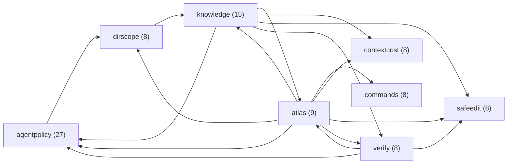

# Modules

Part of [HEADRON](HEADRON.md). What each instrument proves is in [INSTRUMENTS](INSTRUMENTS.md).

<!-- BEGIN generated: module-map (python scripts/atlas.py index --write) -->
116 modules and 363 imports between them, read from the source; 59 test modules are left out of the rows. In the diagram an arrow is an import and the number is how many modules use that hub. `atlascore` is left out of the diagram and the imports column, because 87 modules use it. These 52 rows are the modules at least 2 others use; the other 64, entry points and single-use helpers, are in [MODULES-LEAVES.md](MODULES-LEAVES.md).

| module | what it is | used by | imports | tested by |
|---|---|---:|---|---|
| [atlascore](../scripts/atlascore.py) | Atlas primitives: the declared rosters, the file readers and the router | 87 | agentpolicy, atlas, treeformat, verify | [agent_test](../scripts/agent_test.py), [agents_test](../scripts/agents_test.py) +12 |
| [agentpolicy](../scripts/agentpolicy.py) | The agent execution policy: six verdicts, decided from a declaration rather than from prose | 27 | agenteffects, agentvocab, dirscope, headronlang, packmanifest, processpolicy, shellsplit | [agent_properties_test](../scripts/agent_properties_test.py), [agent_test](../scripts/agent_test.py) +7 |
| [knowledge](../scripts/knowledge.py) | Where a fact may live, how it is retrieved, and the asymmetries underneath both | 15 | agentaudit, agentpolicy, agents, agreement, atlas, boundedinput, contextcost, hostshape, port, runtime, safeedit, verify | [agents_test](../scripts/agents_test.py), [atlas_landing_test](../scripts/atlas_landing_test.py) +3 |
| [atlas](../scripts/atlas.py) | Atlas router + repository contract | 9 | agentpolicy, agreement, atlasgen, atlasindex, atlasinv, branchstate, cidrift, commands, consumergates, contextcost, dateclaims, decide, decide_cli, declcheck, dirscope, doctor, gateplace, headronlang, identity, knowledge, onboard, packmanifest, parsegate, roster, safeedit, verify | [agents_test](../scripts/agents_test.py), [atlas_guards_test](../scripts/atlas_guards_test.py) +7 |
| [commands](../scripts/commands.py) | What Headron answers, in one place: the parser, the roster, and dispatch to declared instruments | 8 |  | [cli_test](../scripts/cli_test.py), [clihelp_test](../scripts/clihelp_test.py) +1 |
| [contextcost](../scripts/contextcost.py) | What this repository HANDS OVER before it is asked anything — measured, and ratcheted | 8 | importgraph, intake | [deps_test](../scripts/deps_test.py) |
| [dirscope](../scripts/dirscope.py) | Directory scopes: what a PLACE in this repository is, what a change here must prove, and the traps already… | 8 | knowledge | [atlas_rules_test](../scripts/atlas_rules_test.py), [cli_test](../scripts/cli_test.py) +1 |
| [safeedit](../scripts/safeedit.py) | Edits that cannot fail silently: an anchor that must match once, and a write that is read back | 8 |  | [atlas_guards_test](../scripts/atlas_guards_test.py), [atlas_landing_test](../scripts/atlas_landing_test.py) +3 |
| [verify](../scripts/verify.py) | What ACTUALLY passed: run the declared done set, one verdict per gate, read off the exit code | 8 | agentpolicy, agents, atlas, branchstate, edges, impact, localtools, receipt, resilience, runtime, safeedit, upstream | [atlas_guards_test](../scripts/atlas_guards_test.py), [atlas_landing_test](../scripts/atlas_landing_test.py) +9 |
| [atomicfile](../scripts/atomicfile.py) | Replace one file whole: a reader sees the old bytes or the new ones, never a torn file | 7 |  | [atomicfile_test](../scripts/atomicfile_test.py) |
| [packmanifest](../scripts/packmanifest.py) | The language tool manifest contract — ONE reader for tools/tools.schema.json | 7 | agentpolicy | [atlas_guards_test](../scripts/atlas_guards_test.py), [atlas_test](../scripts/atlas_test.py) +1 |
| [headronlang](../scripts/headronlang.py) | The surface notation: a `.headron` program compiles to the task contract this repository enforces | 6 | agenteffects, agentpolicy, dirscope, knowledge | [agent_test](../scripts/agent_test.py), [atlas_rules_test](../scripts/atlas_rules_test.py) |
| [importgraph](../scripts/importgraph.py) | One reading of what a Python module imports, and the module map drawn from that reading | 6 |  | [importgraph_test](../scripts/importgraph_test.py) |
| [resilience](../scripts/resilience.py) | Retry what can succeed, refuse what cannot, and never hammer what is down | 6 |  | [agent_test](../scripts/agent_test.py), [atlas_test](../scripts/atlas_test.py) +3 |
| [agents](../scripts/agents.py) | Which agent sessions are live on this machine: the registry Headron Desktop counts | 5 | agentaudit, atomicfile, runtime | [agents_test](../scripts/agents_test.py), [bounds_test](../scripts/bounds_test.py) +1 |
| [branchstate](../scripts/branchstate.py) | Unpushed work, bounded by what actually grows — not by how many branches hold it | 5 | agents, cilocal, consumergates, doctor, gaterunner, ghaudit, verify | [atlas_guards_test](../scripts/atlas_guards_test.py), [atlas_landing_test](../scripts/atlas_landing_test.py) +6 |
| [decide](../scripts/decide.py) | Compiled decision table engine — the System One core | 5 |  | [decide_test](../scripts/decide_test.py), [reflex_test](../scripts/reflex_test.py) |
| [port](../scripts/port.py) | port — plug any agent into everything Headron knows about what it is touching: one call, three lenses, five… | 5 | agreement, atlas, commands, dirscope, knowledge, localtools, sweep, upstream | [atlas_rules_test](../scripts/atlas_rules_test.py), [sweep_test](../scripts/sweep_test.py) +1 |
| [runtime](../scripts/runtime.py) | Which agent runtime produced a change — resolved once, recorded on every verification | 5 |  | [runtime_test](../scripts/runtime_test.py) |
| [abtest](../scripts/abtest.py) | Does the atlas actually help a model? Three arms, one model, automatic scoring | 4 | agentpolicy, atlasinv, contextcost, providers, resilience | [agent_test](../scripts/agent_test.py), [bounds_test](../scripts/bounds_test.py) +1 |
| [agentaudit](../scripts/agentaudit.py) | The audit stream: a hash chain, not a log | 4 |  | [agent_properties_test](../scripts/agent_properties_test.py), [agent_test](../scripts/agent_test.py) +2 |
| [agreement](../scripts/agreement.py) | The agreement graph: which file implements which declaration, and what a diff puts at risk | 4 | atlasinv, commands | [atlas_landing_test](../scripts/atlas_landing_test.py), [atlas_rules_test](../scripts/atlas_rules_test.py) +1 |
| [atlasgen](../scripts/atlasgen.py) | Every document section and file GENERATED from atlas.yaml, and the writer that repairs them | 4 | abtest, chatskill, commands, contextcost, dirscope, entryglance, exrun, knowledge, packmanifest, textguard | [atlas_test](../scripts/atlas_test.py), [edge_cases_test](../scripts/edge_cases_test.py) +2 |
| [atlasinv](../scripts/atlasinv.py) | The hard invariants: one function per promise, and the roster that refuses an unowned one | 4 | agentpolicy, atlasgen, cacheinv, callshape, cidrift, contextcost, declcheck, failureledger, knowledge, langbar, leaks, nativetools, orphans, packmanifest, plantcheck, roster, scoreboard, testgroups, yamlshape | [atlas_test](../scripts/atlas_test.py), [edge_cases_test](../scripts/edge_cases_test.py) +2 |
| [localtools](../scripts/localtools.py) | The tool a project installed for itself, found where its package manager put it | 4 |  | [localtools_test](../scripts/localtools_test.py) |
| [agenteffects](../scripts/agenteffects.py) | Effects: what a task may DO, as a kind rather than as a path or a command name | 3 | agentpolicy | [agent_test](../scripts/agent_test.py) |
| [boundedinput](../scripts/boundedinput.py) | Bounded UTF-8 stdin for hooks and local decision requests | 3 |  | [readiness_test](../scripts/readiness_test.py) |
| [cidrift](../scripts/cidrift.py) | Drift guard: every script a CI workflow runs is a declared gate, or is named as CI-only | 3 |  |  |
| [consumergates](../scripts/consumergates.py) | Consumer gate discovery, shared by landing and verification | 3 |  |  |
| [graph](../scripts/graph.py) | Knowledge graph module — pointers, links, tags, edges, and tunnels | 3 |  | [decide_test](../scripts/decide_test.py) |
| [receipt](../scripts/receipt.py) | Headron receipt v1: one verify run as a record that verifies from its own bytes | 3 | receiptsign, safeedit | [gitobject_test](../scripts/gitobject_test.py), [receipt_test](../scripts/receipt_test.py) +1 |
| [reflex](../scripts/reflex.py) | Command classification primitives — single-pass diff and command classification | 3 | branchstate, callshape, decide, importgraph, port | [reflex_test](../scripts/reflex_test.py) |
| [roster](../scripts/roster.py) | instrument_roster: which scripts are instruments, and which instrument no gate reaches | 3 | cidrift, dirscope, importgraph | [atlas_rules_test](../scripts/atlas_rules_test.py) |
| [sweep](../scripts/sweep.py) | Fast semantic sweep: repo-wide understanding, sharding, joint embeddings, edges, pointers, tunnels | 3 | graph, port | [sweep_test](../scripts/sweep_test.py) |
| [testgroups](../scripts/testgroups.py) | Run independent planted groups without losing later diagnostics to one failed fixture | 3 | agents, impact | [atlas_guards_test](../scripts/atlas_guards_test.py), [atlas_landing_test](../scripts/atlas_landing_test.py) +8 |
| [adaptive](../scripts/adaptive.py) | Deterministic second-stage process selection for Mind | 2 | mind, mind_diagnostics |  |
| [atlasindex](../scripts/atlasindex.py) | A retrieval index that obeys the policy this repository declares, instead of describing one | 2 | graph, port, sweep | [atlas_guards_test](../scripts/atlas_guards_test.py), [atlas_test](../scripts/atlas_test.py) +1 |
| [callshape](../scripts/callshape.py) | forbidden_calls_are_refused: "no module outside X may call Y" is a declared ROW, not a function | 2 | agentpolicy | [atlas_rules_test](../scripts/atlas_rules_test.py), [atomicfile_test](../scripts/atomicfile_test.py) +1 |
| [declcheck](../scripts/declcheck.py) | declarations_are_read: a block in atlas.yaml that no program reads is a promise, so each is read here | 2 | abtest, agentpolicy, commands, delegate, knowledge, workflowbench | [agent_test](../scripts/agent_test.py), [vanish_test](../scripts/vanish_test.py) +1 |
| [doctor](../scripts/doctor.py) | doctor — can THIS machine run each instrument, and what does it cost when one cannot? | 2 | agentpolicy, agreement, atlas_cli, githubapp | [atlas_test](../scripts/atlas_test.py), [bounds_test](../scripts/bounds_test.py) |
| [entryglance](../scripts/entryglance.py) | The first-glance answers every entry renders: what Headron is, is not, needs, and writes | 2 | onboard |  |
| [gateplace](../scripts/gateplace.py) | Where one gate runs for one file, and whether running it there proves anything | 2 |  | [atlas_landing_test](../scripts/atlas_landing_test.py) |
| [gaterunner](../scripts/gaterunner.py) | Bounded process capture shared by verification, landing and local enforcement | 2 |  | [readiness_test](../scripts/readiness_test.py) |
| [gitobject](../scripts/gitobject.py) | Git's object identity, computed in this process: no `git` is spawned, so a hook can answer with zero shell… | 2 |  | [gitobject_test](../scripts/gitobject_test.py) |
| [headron_mcp](../scripts/headron_mcp.py) | Headron as an MCP server: the same commands `headron` answers, offered as tools over stdio | 2 | agents, atlas, commands, mind_verifier | [agents_test](../scripts/agents_test.py), [atlas_guards_test](../scripts/atlas_guards_test.py) +3 |
| [impact](../scripts/impact.py) | The runtime test-impact map: which repository files each planted group ACTUALLY loads, keyed on content hashes | 2 | atomicfile, importgraph, safeedit, testgroups, verify | [atlas_rules_test](../scripts/atlas_rules_test.py), [impact_test](../scripts/impact_test.py) |
| [mind](../scripts/mind.py) | Headron Mind API — unified orchestration layer for agent workflows | 2 | adaptive, agentpolicy, atlasindex, decide, graph, knowledge, mind_diagnostics, port, receipt, reflex, safeedit, slot, sweep, verify | [mcp_test](../scripts/mcp_test.py), [mind_test](../scripts/mind_test.py) |
| [mind_diagnostics](../scripts/mind_diagnostics.py) | Headron Mind API Diagnostics & Recovery — failure diagnosis and remediation | 2 | adaptive, knowledge, mind |  |
| [onboard](../scripts/onboard.py) | `headron init`: the first five minutes in a repository, in one command | 2 | branchstate, consumergates, enforce, localtools, verify |  |
| [providers](../scripts/providers.py) | Where a measurement may send a prompt: OpenAI-compatible endpoints, their key NAMES, their pace | 2 | atomicfile, resilience | [agent_test](../scripts/agent_test.py) |
| [slot](../scripts/slot.py) | A few heavy suites per MACHINE, across every repository and every agent: `headron slot -- <command>` | 2 | resilience |  |
| [upstream](../scripts/upstream.py) | THE UPSTREAM COUNT (3.53.0): commits on the default branch that a lane does not carry | 2 |  | [upstream_test](../scripts/upstream_test.py) |
<!-- END generated: module-map -->
