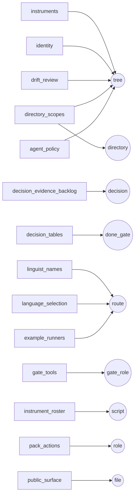

# Pointers

Part of [INDEX](INDEX.md). Every name in [atlas.yaml](../atlas.yaml) that points at something else is a row in `pointers`, read by [pointers.py](../scripts/pointers.py). A new pointer is a row, not a loop.

<!-- BEGIN generated: pointer-table (python scripts/atlas.py index --write) -->

| where in atlas.yaml | must be | names now |
|---|---|---:|
| `agent_policy/schema` | tree | 1 |
| `agent_policy/reference_contract` | tree | 1 |
| `example_runners/@` | route | 39 |
| `pack_actions/*/role` | role | 11 |
| `gate_tools/*/role` | gate_role | 64 |
| `decision_tables/gate_categories/*/*` | done_gate | 9 |
| `drift_review/structural/*` | tree | 10 |
| `directory_scopes/@` | directory | 22 |
| `directory_scopes/*/never/*` | tree | 7 |
| `identity/banner` | tree | 1 |
| `public_surface/network_modules/*` | file | 9 |
| `instruments/*/script` | tree | 95 |
| `instrument_roster/not_a_script/@` | script | 100 |
| `instrument_roster/unreached/@` | script | 9 |
| `language_selection/*/packs/*` | route | 60 |
| `linguist_names/@` | route | 40 |
| `decision_evidence_backlog/*` | decision | 0 |
<!-- END generated: pointer-table -->

A file-shaped string outside these rows has to resolve in the tree too, unless `pointers/foreign` declares that its place names a file in a consuming project. The compound checks stay with their instruments: `front_end/reads` filters fragments, `markdown_policy/oversize` asks a class, `issue_routes` reads six vocabularies, and `context_policy/entry_paths` measures sizes.
